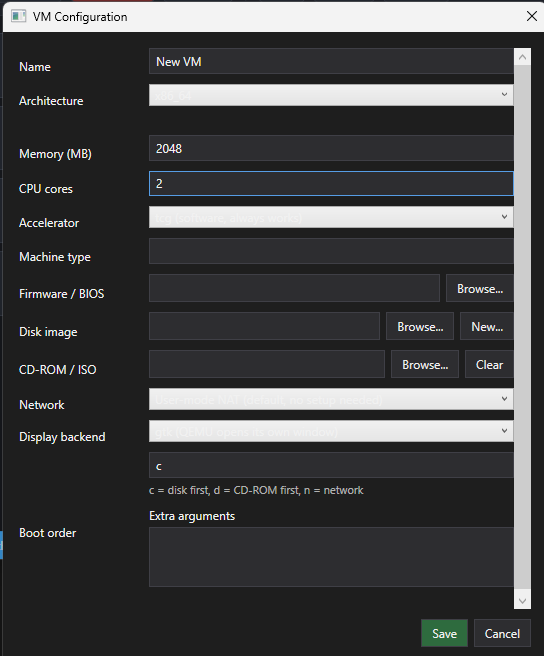

# UHP Desktop + riscv-emu

> **Experimental, work in progress.** Built as a learning/reverse-
> engineering project, not a production hypervisor - see [Status](#status)
> below for what works and what doesn't yet, and
> [Reporting bugs](#reporting-bugs) if something breaks.

A Windows desktop Environment manager (**UHP Desktop**, .NET 8/WPF) paired
with a hand-written RISC-V system emulator (**riscv-emu**) built from
scratch in C and verified at every step against real QEMU.

- **UHP Desktop** (`QemuManager/`) manages Environments two ways: real
  QEMU Environments (it drives `qemu-system-*.exe` over QMP, the same way
  virt-manager or GNOME Boxes do) and `riscv-emu` Environments (its own
  process, driven directly - no QEMU involved at runtime for those).
- **riscv-emu** (`riscv-emu/`) is an RV64IMAFDC(Zicsr,Sstc) interpreter
  that boots a real, unmodified riscv64 Linux kernel to an interactive
  shell, with virtio-blk/virtio-net and real-time guest clock semantics -
  see [`riscv-emu/README.md`](riscv-emu/README.md) for the full phase-by-phase
  build log and every bug found along the way.



## Status

**Works (as of v0.6.0):** creating/running/stopping both real QEMU
Environments and riscv-emu Environments, including a bare-metal ELF
workload with a GDB stub attachable via lldb/gdb (roadmap item 3 - see
[Vision](#vision) below); a real terminal console (xterm.js - colors,
cursor movement, Ctrl+C, copy/paste) with a graceful Shut Down that
waits for the guest to exit on its own; live CPU/memory stats; a
portable, no-installer release build. Every page in the sidebar is
real, not a placeholder:
- **Engines** - each engine's own install path, `--version`, status
  (found/not found/error), supported architectures, and how many
  Environments use it; paths are changed here (Browse re-validates
  immediately), not in Settings any more.
- **Storage** - every disk any Environment uses, plus a small registry
  of disks created or added by hand that survives its own Environment
  being deleted; create (raw or qcow2, MB/GB, never silently
  overwrites an existing file), add an existing one, remove from the
  list (un-registers only - never deletes the file itself).
- **Host** - this machine's OS/CPU/RAM/free disk space and WHPX
  availability, plus how many Environments are running and their
  summed CPU/memory.
- **Recent Tasks**, Storage, Networking, and Environments: every grid
  column is resizable (remembered between runs), has a tooltip with
  the full value, and a double-click opens a detail view with copy.

**Does not work yet:**
- **Networking** is a read-only overview (engine, mode, guest/gateway
  address per Environment) - no port forwarding, no bridged or custom
  network topologies yet; per-Environment disk/network settings
  themselves (in the Environment's own Edit window) already work.
- `make gdb-test` (riscv-emu's own GDB stub, differentially verified
  against real QEMU through lldb) is skipped in CI - the choco-
  installed lldb crashes on GitHub's own Windows runner; it runs and
  passes locally. See [`vision/NEXT.md`](vision/NEXT.md).
- UEFI/firmware development on x86_64, VM snapshots, and a third
  engine (roadmap items 4 and 5) have not been started.
- Windows only; a web UI and a CLI are later ideas in the roadmap, not
  yet started.

See [`vision/VISION.md`](vision/VISION.md) for the full roadmap this
status tracks against, and
[`QemuManager/ARCHITECTURE_AUDIT.md`](QemuManager/ARCHITECTURE_AUDIT.md)
for a point-in-time (2026-11-13, pre-`IEngine`) architecture audit -
most of its findings are already fixed; see its own note at the top
for which, and where the current equivalent is documented.

## Vision

Where this project is headed: a platform/workload-centric lab for
running anything emulated or virtualized (operating systems, firmware,
kernels/bootloaders, bare-metal/embedded programs), with QEMU and
riscv-emu as two interchangeable engines behind one model rather than
two separate per-engine tools - see [`vision/VISION.md`](vision/VISION.md)
for the full architecture, data model, and the incremental roadmap
(one thin end-to-end slice before breadth, same as everything else in
this project).

## Requirements

- Windows 10/11 (x64).
- [.NET 8 runtime](https://dotnet.microsoft.com/download/dotnet/8.0) to
  run UHP Desktop (the portable release bundle has no other
  prerequisite).
- A QEMU install if you want to run real QEMU Environments -
  `winget install --id SoftwareFreedomConservancy.QEMU -e`, or an
  installer from [qemu.org](https://www.qemu.org/download/#windows) /
  [qemu.weilnetz.de](https://qemu.weilnetz.de/w64/). Not needed at all
  for `riscv-emu` Environments - UHP Desktop works with only those and no QEMU
  install anywhere on the machine.
- To **build** riscv-emu yourself (not required to just run it): a
  portable GCC such as [w64devkit](https://github.com/skeeto/w64devkit)
  for the interpreter itself, and LLVM/clang (for the guest test
  programs riscv-emu's own test suite compiles and runs).

## Quick start - using it

1. Download the latest release's `UHP-Desktop-portable.zip` from this
   repo's [Releases](../../releases) page and extract it anywhere.
2. Run `QemuManager.exe`. No installer, no admin rights needed.
3. Click **+ New Environment**, choose **Kernel / Bootloader**, point it
   at a kernel Image (and optionally an initramfs) - see the note below
   on where to get one - and click **Power On**.
4. The console window that opens is the guest's own UART - type into it
   like a terminal (`Ctrl+C` works, arrow keys work, `Send Ctrl+C` button
   if you'd rather click).

**A heads-up on the guest kernel:** this repo does not commit a riscv64
Linux kernel/initramfs to git (see [`THIRD_PARTY.md`](THIRD_PARTY.md) for
why - GPL source-availability obligations, and no confidently-known
source for the specific binaries used during this project's own early
development). It is fetched instead: run
`riscv-emu/scripts/fetch-guest-images.ps1` (or `.sh`) to download a real,
from-scratch, fully reproducible Buildroot build (Linux 6.18.64 - see
[`THIRD_PARTY.md`](THIRD_PARTY.md) for exactly what it targets and how it
is verified) from this repo's own
[`guest-images-v1`](../../releases/tag/guest-images-v1) release, then
point a new riscv-emu Environment at the `boot/KernelImage` and
`boot/initramfs.cpio.gz` it extracts. The fetch itself needs nothing
extra - a plain HTTPS download, same as any other release asset; the
[GitHub CLI](https://cli.github.com/) (`gh`) is only used as a fallback
if that download fails for some reason (a proxy/firewall blocking
github.com's own release-asset host, for instance). (Real QEMU Environments need
neither - point UHP Desktop at an existing disk image/ISO the same way
any QEMU front end would.)

## Quick start - building it

```sh
# riscv-emu (needs w64devkit's gcc + LLVM's clang on PATH - see SETUP
# notes in riscv-emu/README.md if you don't have these yet)
cd riscv-emu
make                 # builds riscv-emu.exe
make test            # unit test, this emulator only
make compare         # differential: byte-for-byte against real qemu-system-riscv64
make test-all         # the fast suite: unit + differential + integration

# UHP Desktop (needs the .NET 8 SDK)
cd ../QemuManager
dotnet build QemuManager.SelfTest/QemuManager.SelfTest.csproj -c Release
dotnet QemuManager.SelfTest/bin/Release/net8.0/QemuManager.SelfTest.dll \
    "C:\Program Files\qemu" "..\riscv-emu"   # exercises both engines, no window needed
dotnet build QemuManager/QemuManager.csproj -c Release   # the WPF app itself
```

See [`riscv-emu/README.md`](riscv-emu/README.md) and
[`QemuManager/README.md`](QemuManager/README.md) for everything else -
architecture, every bug found and fixed, and why each design decision was
made. [`QemuManager/ARCHITECTURE_AUDIT.md`](QemuManager/ARCHITECTURE_AUDIT.md)
tracks known risks and planned work.

## Reporting bugs

Open an [issue](../../issues/new?template=bug_report.md) - there's a
template that asks for the version/commit, Windows version, and (if
UHP Desktop crashed or misbehaved) the matching file from its own
`logs` folder, which is usually what actually explains what happened.

## License

GPL-3.0 - see [`LICENSE`](LICENSE). Third-party components and their own
licenses are listed in [`THIRD_PARTY.md`](THIRD_PARTY.md).
